# eKYC Verification Pipeline

[](https://github.com/AbhishekChandra961/eKYC-Verification/actions/workflows/ci.yml)
[](https://github.com/AbhishekChandra961/eKYC-Verification/actions/workflows/pages.yml)

**Live demo: <https://abhishekchandra961.github.io/eKYC-Verification/>**: replays of real pipeline runs in your browser,
no install (see [Live demo](#live-demo) for what it is and isn't).

A digital **Know-Your-Customer (KYC)** onboarding system for a fictional bank, "SecureBank". The customer uploads a
photo of an identity document and takes a selfie. Four independent AI checks then run in parallel:
- **document type:** a CNN classifier;
- **forgery:** a tile-based CNN with a heatmap;
- **face match:** the selfie against the ID portrait;
- **field extraction:** a local vision LLM, plus MRZ check-digit and consistency rules.

A rule-based decision engine combines them into *auto-approve*, *manual review* or *resubmit*, and **never rejects on its
own**: only a bank officer can reject, with a mandatory reason, and every step is audited. Everything is built in
Python and TypeScript as event-driven microservices over Kafka, with a React frontend, Docker packaging, CI and a Tableau
dashboard. The models are trained and evaluated only on synthetic identity documents (SIDTD) and on a public face
benchmark (LFW).

> **Capstone project** for a postgraduate programme in data science. A research and teaching prototype: not validated
> on real identity documents, and not for real KYC decisions.

## Live demo

**<https://abhishekchandra961.github.io/eKYC-Verification/>**: the real React frontend, built in *demo mode* and
hosted free on GitHub Pages. Click **Try as customer** or **Try as officer**; no account or password is needed.

| | |
|---|---|
| 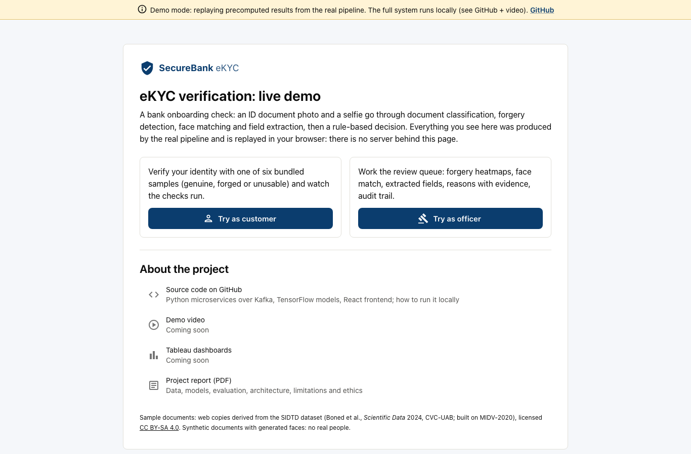 | 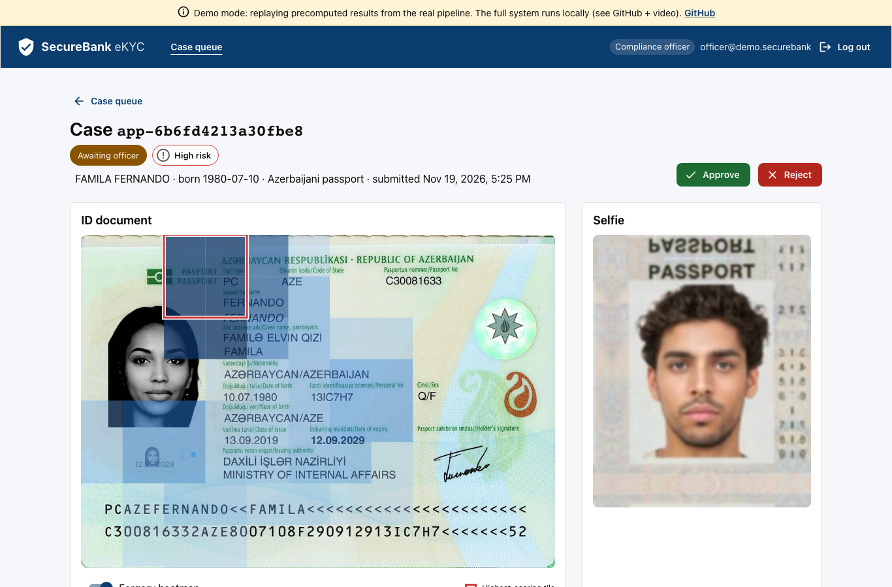 |

**What it is:**
- **Real results, replayed.** The six demo samples (3 genuine, 2 forged, 1 unusable photo) were run through the full
  system on 19 Nov 2026 (`scripts/export_demo_fixtures.py`).
  - As the customer, you pick one and watch its recorded status updates replay at their real relative times, sped up
    so that a case finishes in about 10 s. The status page says which real run it is and how much it is sped up.
  - As the officer, you see 15 cases exactly as the API returned them: the six samples and nine applications from the
    Phase 9 batch. Each has its forgery heatmap, face match, extracted fields, reasons with evidence, summaries and
    audit trail. Their "Waiting" times are shown at the time of recording, so they do not grow with today's date.
- **The same pages as the real app.** A second implementation of the same typed API client serves fixtures instead of
  HTTP (`frontend/src/demo/`), so every screen is the production component.
- **Honest by construction.**
  - A banner on every page says it is a replay.
  - The demo client never calls the network and never computes or invents a result.
  - Vitest and a Playwright run against the built site test all of this.

**What it isn't:**
- **Not the running system.** No Kafka, workers, models or LLM run in the browser; nothing is computed. The full system
  runs locally ([Quickstart](#quickstart)) and in the demo video.
- **No uploads.** Your own photos are refused with a message, and the camera is never switched on: there is no real run
  to replay for them.
- **Decisions are not saved.** Officer approve/reject works in your browser tab only and is gone on reload (it is
  labelled as such in the dialog and in the audit trail).

Build it yourself: `cd frontend && npm run build:demo` (output in `dist-demo/`, served under `/eKYC-Verification/`),
`npm run preview:demo` to serve it locally, and `npm run e2e:demo` for the browser test. Deployment:
[`.github/workflows/pages.yml`](.github/workflows/pages.yml) builds, tests and publishes the site on every push to
`main`.

## Highlights

- **Layered checks, not one black box:**
  - four checks, each with its own evidence, are combined by a transparent, unit-tested decision engine;
  - an uncertain check, a timeout or a missing face sends the case to an officer; nothing is auto-rejected.
- **The shortcut-learning story:**
  - the first forgery model scored **PR-AUC 0.976** on validation but had learned *how the files were made*, not the
    edits: it was near chance on templates alone, and Grad-CAM was on the edit for 0 of 179 forgeries;
  - two rounds of diagnosis (recording style, then JPEG compression history) and a **position-matched negative
    control** produced v3;
  - v3 finds the edit (the top tile lies on the altered field for **95.3 %** of forged test pages) and scores
    **ROC-AUC 0.976 / PR-AUC 0.984** on the one-time test run.
- **98.5 % fraud catch in a 150-application batch** run through the whole live system:
  - **67 of 68** forged or mismatched applications were not auto-approved;
  - all **45 of 45** forged documents went to review, all 4 Crop_and_Replace forgeries among them;
  - the honest cost: 27 of 75 legitimate applications also went to review (see *Results*).
- **Event-driven architecture:** Kafka orchestration with fan-out/fan-in, the claim-check pattern (events carry S3
  keys, never images), at-least-once processing with idempotent upserts, retries with backoff, a dead-letter queue
  and a timeout sweeper.
- **Privacy by design:**
  - the vision LLM runs **on-premises** (Ollama), so no document leaves the machine;
  - **customers never see fraud signals**, only a neutral outcome;
  - PII is masked in logs;
  - the dashboard exports are pseudonymous;
  - only synthetic documents are used.
- **Engineering hygiene:**
  - leakage-safe group splits; every test set was used once;
  - 257 pytest tests, 80 Vitest tests, 4 Playwright end-to-end tests on the live system and 5 on the demo site;
  - GitHub Actions CI and Pages deployment; non-root Docker images; deterministic, checksum-verified model release.

## Architecture

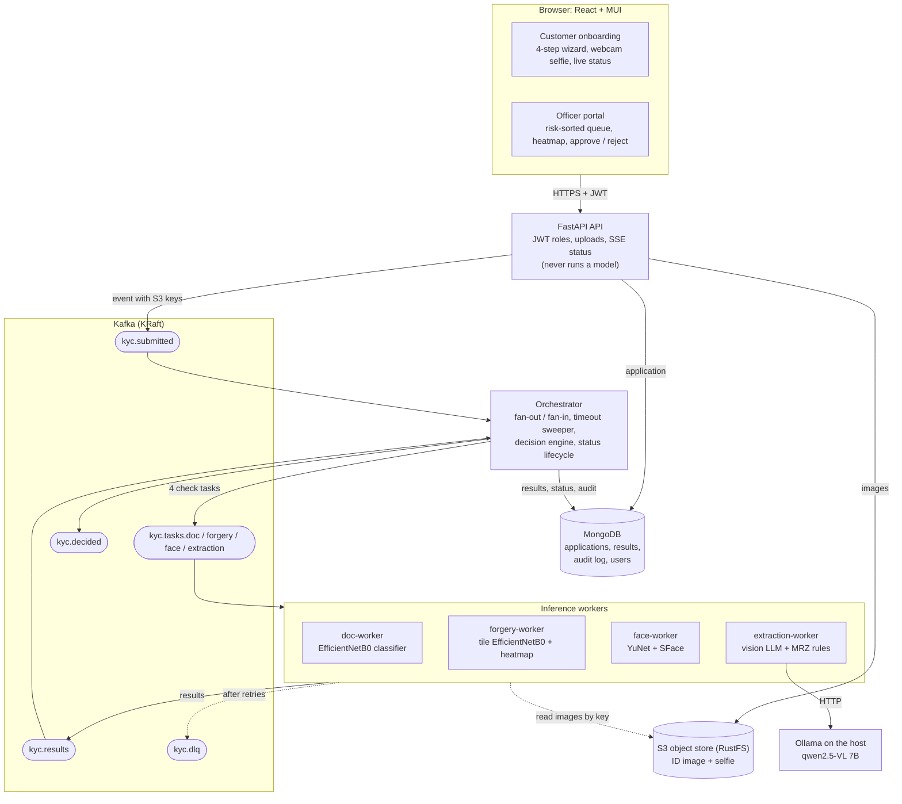

| Component | Path | Role | Built with |
|---|---|---|---|
| API | `services/api` | Login (JWT roles CUSTOMER / OFFICER), uploads, live status (Server-Sent Events), officer endpoints. Thin: never runs a model | FastAPI, PyJWT, argon2 |
| Orchestrator | `services/orchestrator` | Publishes the four check tasks, collects results, marks late checks `timed_out`, runs the decision engine, moves the status and writes the audit log | confluent-kafka, pymongo |
| doc-worker | `services/doc-worker` | Document type (10 classes) and "unrecognized document" | Keras EfficientNetB0 |
| forgery-worker | `services/forgery-worker` | Forgery score and tile heatmap for the officer | Keras EfficientNetB0 on 224 px tiles |
| face-worker | `services/face-worker` | Selfie vs ID portrait (cosine similarity) | OpenCV YuNet + SFace (ONNX) |
| extraction-worker | `services/extraction-worker` | Printed fields and MRZ as validated JSON, then MRZ check digits and consistency rules | Ollama qwen2.5-VL 7B, Pydantic |
| Decision engine | `src/ekyc/decision.py` | A pure function: four check results + typed details → outcome, risk score, reasons with evidence | Python |
| Frontend | `frontend/` | Customer wizard and status, officer queue and case detail | React 19, TypeScript, Vite, MUI |
| Infrastructure | `docker-compose.yml` | Kafka (KRaft), Kafka UI, MongoDB 8, RustFS (S3-compatible) | Docker Compose |
| Dashboard | `dashboard/` | Operations, risk & fraud, model performance | Tableau Public, from pseudonymous CSV exports |

**Status lifecycle:**
- `SUBMITTED → PROCESSING`, then one of:
  - `APPROVED`: auto-approved by the system;
  - `RESUBMIT_REQUESTED`: unusable image;
  - `DECIDED`: manual review, waiting for an officer, who then moves it to `APPROVED` or `REJECTED`.
- Every transition is checked atomically and audited.
- Details: [`services/README.md`](services/README.md).

## Tech stack

| Area | Tools |
|---|---|
| Machine learning | TensorFlow 2.18.1 / Keras 3.15.1 (EfficientNetB0 transfer learning, tensorflow-metal on Apple Silicon), scikit-learn, OpenCV 5 (YuNet, SFace) |
| Generative AI | Ollama + qwen2.5-VL 7B (local vision LLM), Pydantic-validated JSON with retry, ICAO 9303 MRZ rules |
| Backend | Python 3.11, FastAPI, confluent-kafka (Apache Kafka 4.4, KRaft), pymongo (MongoDB 8), boto3 (RustFS S3), JWT + argon2 |
| Frontend | React 19, TypeScript 5.9, Vite 8, MUI 9, React Router 7, Vitest, Playwright, types generated from OpenAPI |
| Ops | Docker (multi-stage, non-root, healthchecks), Docker Compose profiles, GitHub Actions (ruff, pytest, ESLint, tsc, Vitest) |
| Analytics | pandas, matplotlib, Jupyter, Tableau Public |

## Results

Every number below comes from `reports/`, and the full analysis is in the [project report](docs/report/REPORT.md).
Splits are by **document group**, so no document, nor any forgery or video frame of it, crosses splits. Thresholds were
chosen on validation, and **each test set was used once**.

### Document type classifier (EfficientNetB0, frozen backbone, 224 px)

| Split | Images | Accuracy | Macro F1 | Below the 0.77 confidence threshold |
|---|---:|---:|---:|---:|
| validation | 2,118 | 99.01 % | 0.990 | – |
| **test (once)** | 1,962 | **99.29 %** | **0.993** | 1.48 % |

Honest note: it does not reject non-documents reliably, since **16.5 % of LFW face photos pass** its threshold. The
decision engine therefore never trusts it alone.

### Forgery detector: v1 → v2 → v3

| Model | Split | PR-AUC | ROC-AUC | Shortcut checks | Verdict |
|---|---|---:|---:|---|---|
| v1: whole image, 512 px (templates + video frames) | val | 0.976 | 0.986 | templates only: PR-AUC 0.59 (chance 0.54); Grad-CAM on the edit 0 of 179 | **rejected:** learned recording style and JPEG quality |
| v2: 224 px tiles of 1280 px templates | val | 0.983 | 0.974 | position-matched control 0.584 (est_id 0.713); edit-hidden ROC-AUC 0.583 | **rejected:** compression-history cue |
| v3: tiles, equal compression history | val | 0.963 | 0.939 | control 0.491; edit-hidden 0.403; top tile on the edit 93.3 % | accepted |
| **v3, final** | **test (once)** | **0.984** [0.974, 0.992] | **0.976** [0.959, 0.989] | control 0.484; top tile on the edit 95.3 % | **final** |

- **v3 on the test set (190 forged, 148 genuine pages):**
  - at the review threshold **0.729**: recall 0.968, precision 0.840, and 35 genuine pages flagged (23.6 %);
  - at the "suspected" threshold **0.857**: recall 0.937, precision 0.908, and 18 flagged (12.2 %).
- **Brackets** are 95 % bootstrap intervals.
- **Weak spot:** Crop_and_Replace forgeries (real printed text pasted from another document): 14 of 18 caught on
  test, 7 of 22 on validation. The MRZ and consistency rules cover part of this gap (next table).
- **What validation gave up:** v3's lower *validation* score than v2 is the price of removing a shortcut; the
  "edit-hidden" score near 0.5 shows the model no longer wins without seeing the edit.

### Face verification (LFW test, 1,000 pairs, once)

| Model | ROC-AUC | EER | TAR at FAR 1 % | At the threshold (0.2597): FAR / FRR |
|---|---:|---:|---:|---|
| **SFace (production)** | **0.997** | 1.6 % | 98.4 % | 2.2 % / 1.4 % |
| Siamese CNN (showcase, trained here) | 0.779 | 30.0 % | 10.4 % | (not used) |

- **The threshold** was chosen on the LFW *training* pairs (target FAR 1 %).
- **ID portraits are harder:** on synthetic ID portraits, two *different* documents still matched in **29.9 %** of
  pairs, because the generated faces look alike. The decision engine therefore sends scores between 0.2597 and
  0.556 to review.

### Field extraction (qwen2.5-VL 7B, local, 148 genuine test documents)

| Valid JSON | Exact field match | Normalized match | Mean CER | Latency p50 / p95 |
|---:|---:|---:|---:|---:|
| 99.3 % | 84.1 % | 95.2 % | 1.8 % | 31.6 s / 64.1 s |

- **By field (normalized match):**
  - names about 92 % (surname 91.9 %, given names 92.6 %);
  - dates and document numbers about 99 %;
  - the MRZ lines are weakest: 76.7 % and 65.0 %.
- **The rules are sound on ground truth:** at most **0.75 %** false flags, and all 400 MRZs pass every check digit.
- **On *extracted* fields, OCR slips become false flags:** 23 of 60 MRZ passports get at least one flag, mostly the
  given-names cross-check.
- **So MRZ name mismatches only mean "needs review"**, never "forgery suspected".
- **Forgery model OR rules** catches **71 %** of Crop_and_Replace forgeries (17 of 24), against 46 % for the model
  alone.

### End-to-end: 150 applications through the live system (Phase 9)

- **The scenarios** used TEST-split templates only:
  - 50 % genuine;
  - 25 % forged with the fraudster's own selfie;
  - 8 % wrong typed details;
  - 7 % a stranger's selfie;
  - 5 % blank or unreadable images;
  - 5 % forged with a stranger's selfie.
- **Nothing was tuned on this batch.**

| Ground truth ↓ / system → | AUTO_APPROVED | MANUAL_REVIEW | RESUBMIT_REQUIRED | Total |
|---|---:|---:|---:|---:|
| fraud or mismatch | **1** | **67** | 0 | 68 |
| legitimate | **48** | **27** | 0 | 75 |
| unusable image | 0 | 0 | **7** | 7 |

- **Fraud caught: 67 of 68 (98.5 %).**
  - The one miss was a stranger's selfie on a synthetic portrait that scored 0.63, above the review band.
  - All 45 forged documents went to review.
- **Legitimate auto-approved: 48 of 75 (64 %).** The 27 false alarms came from:
  - forgery-model flags (15);
  - the MRZ given-names rule (10);
  - a few date and extraction issues.
- **This is the main production weakness:** a 63 % overall manual-review rate.
- **Officer step:** a simulated officer then decided 66 high-risk cases: 56 rejected, 10 approved.
- **Latency:** median time to decision 77 s under heavy memory pressure (extraction median 29 s).
- **Details:** [`reports/phase9/batch_summary.md`](reports/phase9/batch_summary.md).

## Screenshots

| Customer: details | Customer: webcam selfie |
|---|---|
| 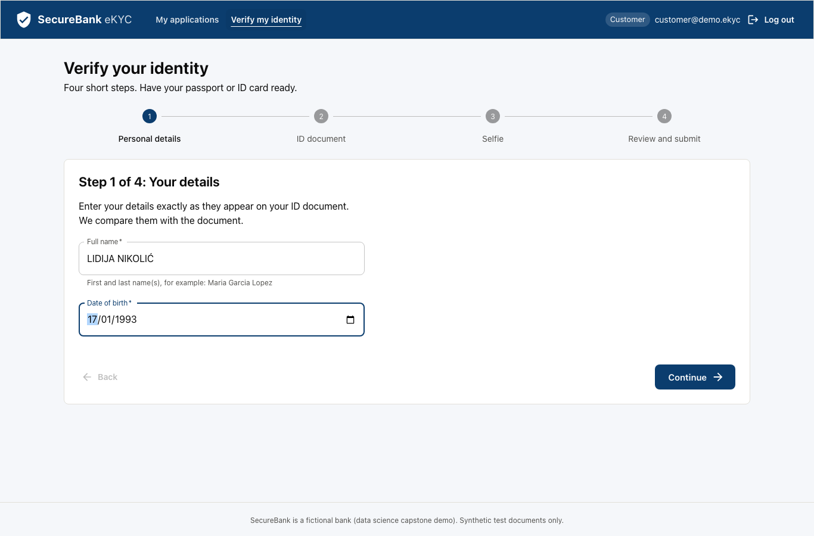 | 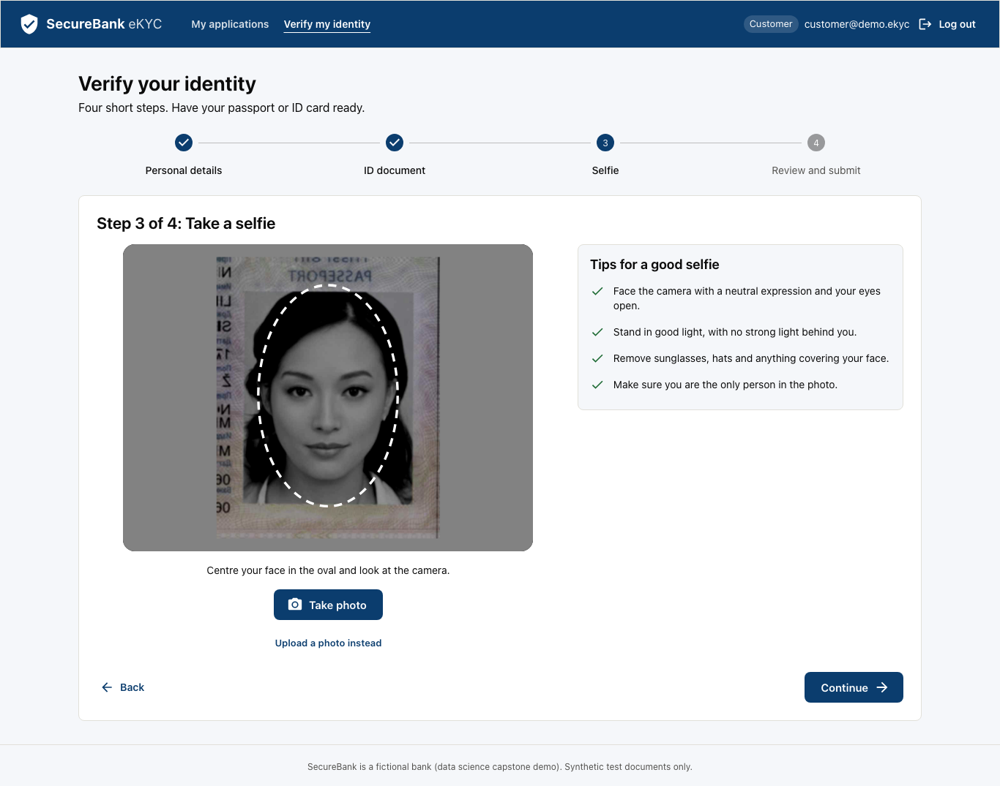 |
| **Customer: verified** | **Customer: please resubmit** |
| 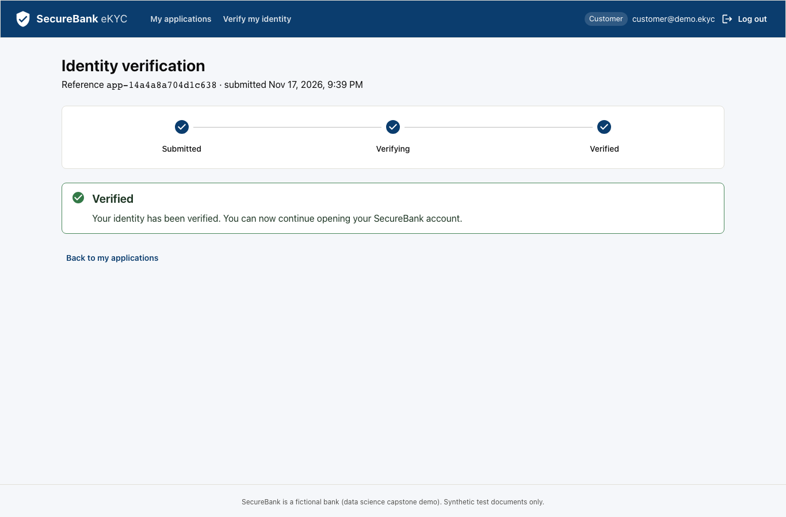 | 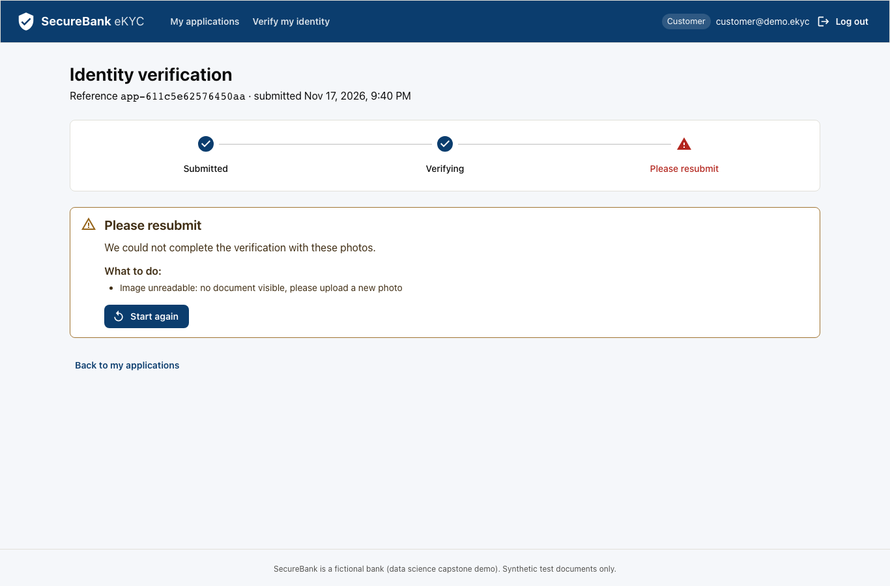 |
| **Officer: risk-sorted queue** | **Officer: case detail** |
| 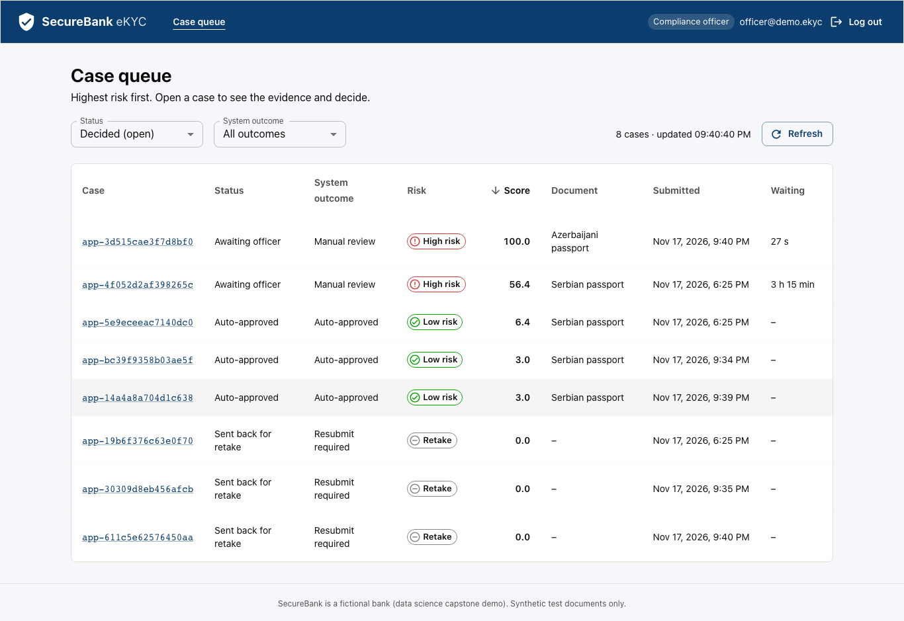 | 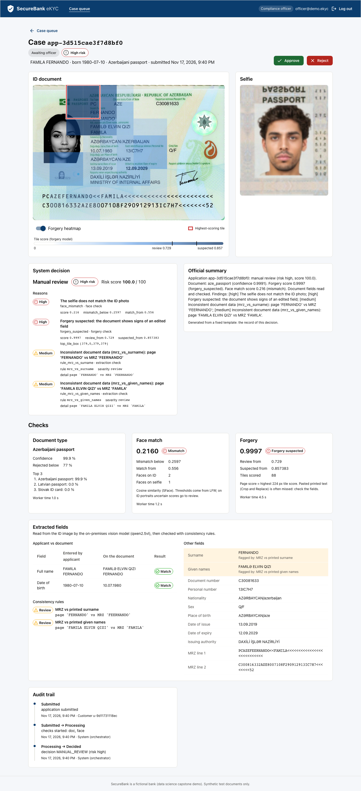 |
| **Officer: forgery heatmap** | **Officer: rejection and audit trail** |
| 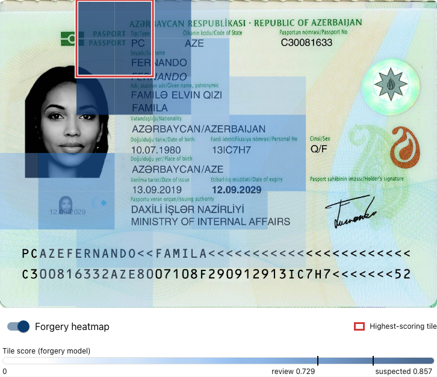 | 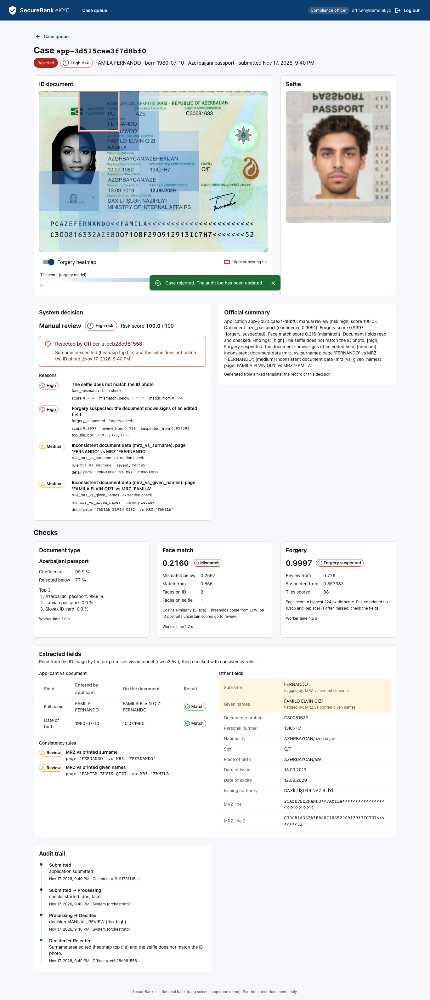 |

## Quickstart

### Prerequisites

| Tool | Notes |
|---|---|
| macOS on Apple Silicon (tested, 16 GB RAM) or Linux | Linux uses plain TensorFlow 2.18.1 CPU; `tensorflow-metal` is installed on macOS only |
| [uv](https://docs.astral.sh/uv/) and Python 3.11 | `uv` installs Python 3.11 if it is missing |
| Node.js 22 + npm | frontend |
| Docker Desktop (Compose v2) | host mode: 4 GB of memory is enough for the infrastructure; container mode: **6 GB** |
| [Ollama](https://ollama.com) | then `ollama pull qwen2.5vl:7b` (about 6 GB download, 6-8 GB RAM while it runs) |
| Disk | about 6 GB: datasets 2.6 GB (templates zip + unpacked), Python environment about 2 GB, models 0.1 GB, node_modules |

### 1. Clone and install

```bash
git clone https://github.com/AbhishekChandra961/eKYC-Verification.git ekyc-verification
cd ekyc-verification
uv venv --python 3.11 .venv
uv pip install --python .venv/bin/python -r requirements.txt   # pinned versions
uv pip install --python .venv/bin/python -e .                  # the shared package src/ekyc (editable)
(cd frontend && npm ci)
```

### 2. Datasets (not in git)

The **SIDTD templates** (1.3 GB) are all the demo needs:

```bash
mkdir -p data/raw data/interim
curl -L -o data/raw/templates.zip http://datasets.cvc.uab.es/SIDTD/templates.zip
unzip -q data/raw/templates.zip -d data/interim/        # -> data/interim/templates/{Images,Annotations}
```

**LFW** face pairs (about 230 MB download, 520 MB on disk, through scikit-learn) are needed for the face notebook and its tests:

```bash
.venv/bin/python -c "from sklearn.datasets import fetch_lfw_pairs as f; [f(subset=s, color=True, resize=1.0, data_home='data/raw/lfw') for s in ('train', 'test')]"
```

Optional, to rebuild the Phase 2 manifest and retrain every model: the **SIDTD video clips** (28.5 GB, a slow server):
`sh scripts/download_sidtd_clips.sh` (resumable; see its header), then
`unzip -q data/raw/clips_cropped.zip -d data/interim/`. The notebooks run in order `01` → `05`.
`data/raw` and `data/interim` are read-only source data; everything derived goes to `data/processed`.

### 3. Trained models (GitHub release, about 100 MB)

```bash
.venv/bin/python scripts/download_models.py
```

This downloads `ekyc-models-v1.0.zip` from the [v1.0.0 release](https://github.com/AbhishekChandra961/eKYC-Verification/releases/tag/v1.0.0),
checks its SHA-256 (stored in `src/ekyc/config.py`) and every file against the zip's `SHA256SUMS`, and unpacks it
into `models/`. With a local copy of the zip: `--zip path/to/ekyc-models-v1.0.zip`.

What the zip holds:
- `doc_classifier.keras`
- `forgery_detector.keras` (v3)
- the YuNet and SFace ONNX files, with their licence files
- `face_siamese.keras` (showcase only)
- the model JSON configs
- a README

The v1/v2 forgery models are left out on purpose: they are the *rejected* comparison models of the shortcut study.
Their configs stay in git as the record.

### 4. Settings

```bash
cp .env.example .env
```

Fill in the empty values in `.env` (the comments show how to generate each):
- `KAFKA_CLUSTER_ID`
- `MONGO_ROOT_PASSWORD`
- `S3_ACCESS_KEY` and `S3_SECRET_KEY`
- `JWT_SECRET`
- `DEMO_CUSTOMER_PASSWORD` and `DEMO_OFFICER_PASSWORD`

`.env` is gitignored: never commit it. `LLM_API_KEY` stays empty: extraction uses the local model.

### 5a. Run in host mode (recommended on a 16 GB laptop)

```bash
docker compose up -d        # Kafka, Kafka UI, MongoDB, RustFS (S3): about 1 GB
ollama serve                # skip if the Ollama app is already running
./scripts/run_all.sh        # API, orchestrator, 4 workers, frontend (logs in logs/services/); Ctrl+C stops them
```

| Page | Address |
|---|---|
| App | http://localhost:5173 |
| API docs | http://localhost:8000/docs |
| Kafka UI | http://localhost:8080 |

On Apple Silicon the workers use the Metal GPU when `EKYC_TF_DEVICE=gpu`; the default is the CPU.

### 5b. Run in container mode (Docker Desktop memory of at least 6 GB)

```bash
docker compose --profile app up -d --build    # + API, orchestrator, 4 workers, frontend (nginx)
```

| Page | Address |
|---|---|
| App | http://localhost:3000 |
| API | http://localhost:8000 |

- **Ollama** still runs on the host; the containers reach it at `host.docker.internal:11434`.
- **Models** are mounted read-only from `./models`.
- **Stop everything:** `docker compose --profile app stop`.
- **Never run both modes at once** (port 8000).
- **Measured:** about 3.3 GB idle and 4.1 GB at peak ([`reports/phase9/docker.md`](reports/phase9/docker.md)).

### 6. Demo accounts and samples

```bash
.venv/bin/python scripts/make_demo_samples.py     # -> demo_samples/ (needs the SIDTD templates of step 2)
```

- **Demo accounts:**
  - customer `customer@demo.ekyc`;
  - officer `officer@demo.ekyc`;
  - both passwords are the `DEMO_*_PASSWORD` values in your `.env`; the API creates both accounts when it starts.
- **Demo samples:**
  - `demo_samples/README.md` lists what to type for each sample: 3 genuine, 2 forged with a stranger's selfie, and
    1 blank image, all synthetic test-split documents;
  - it also lists the outcome to expect for each one.
- **Webcam selfie:** your own face will not match a synthetic ID, so either choose *Upload a photo instead*, or start
  Chrome with the fake webcam described in that README.

### Tests

```bash
.venv/bin/python -m pytest                       # 257 tests; tests needing services, weights or data skip themselves if missing
uvx ruff@0.17.5 check                            # lint
cd frontend && npm run lint && npm run typecheck && npm test   # ESLint, tsc, 80 Vitest tests
cd frontend && npm run e2e                       # Playwright: the whole system in host mode must be running
cd frontend && npm run e2e:demo                  # Playwright against the static demo build (no backend needed)
.venv/bin/python scripts/e2e_api_smoke.py        # API-level end-to-end smoke test (4 cases + 6 security checks)
```

CI ([`.github/workflows/ci.yml`](.github/workflows/ci.yml)) runs ruff, the pytest tests that need no services,
weights or data, and the frontend lint, typecheck and unit tests on every push. The Pages workflow
([`.github/workflows/pages.yml`](.github/workflows/pages.yml)) also runs the demo-site browser test before it deploys.

## Repository layout

```
src/ekyc/            shared package: config, data + splits, models, decision engine, store, messaging, inference
services/            api/, orchestrator/, {doc,forgery,face,extraction}-worker/, Dockerfile, README (operations)
frontend/            React app (customer + officer), Dockerfile (nginx), Playwright e2e; src/demo/ = the static demo site
notebooks/           01 manifest + splits, 02 doc classifier, 03 forgery v1, 03b forgery tiles v3, 04 face, 05 extraction
scripts/             run_all.sh, download_models.py, make_demo_samples.py, simulate_batch.py, export_demo_fixtures.py, ...
reports/phase2-11/   metrics (JSON/CSV), plots, screenshots, batch and Docker reports
dashboard/           data/*.csv (pseudonymous exports), DATA_DICTIONARY.md, TABLEAU_GUIDE.md
docs/                report/ (REPORT.md + DOCX/PDF), VIVA_PREP.md, DEMO_SCRIPT.md, RELEASE_NOTES_v1.0.0.md
tests/               pytest (markers: services, models, data)
```

## Limitations

- **Synthetic data only:**
  - 10 European document types (SIDTD, based on MIDV-2020), flat scans;
  - no Indian documents, no real phone photos, no real selfie-ID pairs;
  - every threshold must be re-calibrated on real data before any production use.
- **High manual-review rate (63 % in the batch):**
  - forgery false alarms cluster on `est_id`;
  - the 7B vision model misreads MRZ name lines.
  - A dedicated MRZ reader or a stronger model would cut this.
- **Crop_and_Replace forgeries** (pasted real text) are the hardest case for the pixel model; the rules only help
  where the MRZ repeats the edited field.
- **Face matching on generated portraits** is weak: 29.9 % of different-document pairs matched. The LFW threshold
  missed one impostor in the batch.
- **Not a full KYC system:**
  - no liveness or anti-spoofing check;
  - no sanctions or PEP screening;
  - no document chip (NFC) reading.
- **Throughput:** one local vision LLM processes extractions one at a time (about 20-30 s each), so concurrent
  applications queue.

## Privacy and ethics

- **No real identities:**
  - documents are synthetic (SIDTD), and their portraits are generated faces;
  - LFW (public-figure photos) is used only to train and evaluate face matching. The dataset is not
    redistributed; a few example pairs appear in the face notebook's figures, as is usual in research reporting.
- **On-premises LLM:** extraction runs locally (Ollama), so identity documents never go to a third-party API. The
  optional cloud path is off by default.
- **Customers never see fraud signals:**
  - the customer screens receive a whitelisted status object, with no forgery or face scores and no rule flags;
  - a unit test fails if fraud-signal names appear in customer code.
  - Officers see all the evidence.
- **Humans decide rejections:** the system never auto-rejects; officers must give a reason, and the audit log is
  append-only.
- **Data minimization:**
  - PII is masked in logs;
  - presigned image links expire;
  - dashboard exports use pseudonymous ids (`C0001`) and a guard rejects PII-like columns.
- **Fairness risk:**
  - the face detector missed one dark, low-contrast ID photo (`est_id_64`);
  - forgery false alarms are uneven across document types.
  - Both would need measurement on representative real data before use.

## Future work

- Calibrate the thresholds on real, consented selfie-ID data; add liveness detection.
- A dedicated MRZ OCR reader, or a stronger extraction model, to cut MRZ name false flags.
- Train the forgery detector on phone photos (screen and print recaptures) and on more Crop_and_Replace forgeries.
- Learn the risk weights from officer decisions (with a human in the loop), and monitor drift per document type.
- Scale-out: several extraction workers or a GPU inference server, Kafka with replication, and Kubernetes.

## Credits and licences

| Resource | Use here | Licence / terms |
|---|---|---|
| **SIDTD**: Boned et al., *Synthetic dataset of ID and Travel Documents*, Scientific Data 11 (2024), CVC-UAB | Training and evaluation of all document models | Creative Commons Attribution-ShareAlike (the paper states CC BY-SA 2.5, as MIDV-2020; the data record, DOI 10.34810/DATA1815, lists CC BY-SA 4.0) |
| **MIDV-2020**: Bulatov et al., Computer Optics 46(2) (2022) | The genuine documents SIDTD is built on (faces are generated) | Citation required; licence accepted on access |
| **LFW**: Huang et al., *Labeled Faces in the Wild*, UMass Amherst (2007) | Face verification training and evaluation (via scikit-learn) | Research benchmark; the dataset is not redistributed (a few example faces appear in report figures) |
| **YuNet** face detector, OpenCV Zoo (`face_detection_yunet_2023mar.onnx`) | Face detection | MIT (licence file shipped with the model) |
| **SFace** face recognizer, OpenCV Zoo (`face_recognition_sface_2021dec.onnx`) | Face embeddings | Apache 2.0 (licence file shipped with the model) |
| **EfficientNetB0** ImageNet weights (Keras Applications) | Backbone of the document and forgery models | Apache 2.0 |
| **Qwen2.5-VL 7B** (via Ollama) | Field extraction | Apache 2.0 |

The SIDTD templates are downloaded by each user from the dataset's server. This repository contains only
derived figures and screenshots of synthetic documents, plus, for the demo site, 26 small web copies of SIDTD-derived
documents and simulated selfies of their generated portraits (`frontend/src/demo/fixtures/images/`, CC BY-SA 4.0,
credited on the site). The trained weights in the release are derived from the
sources above and are shared for research and education.

## More documentation

| Document | What |
|---|---|
| [`docs/report/REPORT.md`](docs/report/REPORT.md) | The full project report (also as DOCX and PDF) |
| [`docs/VIVA_PREP.md`](docs/VIVA_PREP.md) | Likely examiner and interviewer questions, with answers |
| [`docs/DEMO_SCRIPT.md`](docs/DEMO_SCRIPT.md) | The narrated 4-5 minute demo with a shot list |
| [`services/README.md`](services/README.md) | Running and operating the backend: topics, lifecycle, reset, batch, Docker |
| [`frontend/README.md`](frontend/README.md) | The React app: screens, API types, tests |
| [`dashboard/TABLEAU_GUIDE.md`](dashboard/TABLEAU_GUIDE.md) | How to build the three Tableau dashboards |
| [`reports/phase3/summary.md`](reports/phase3/summary.md) | The forgery shortcut story with every number |
