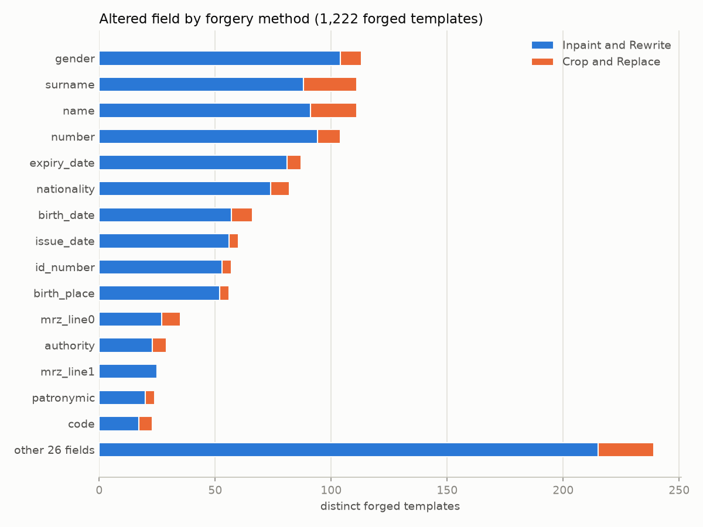
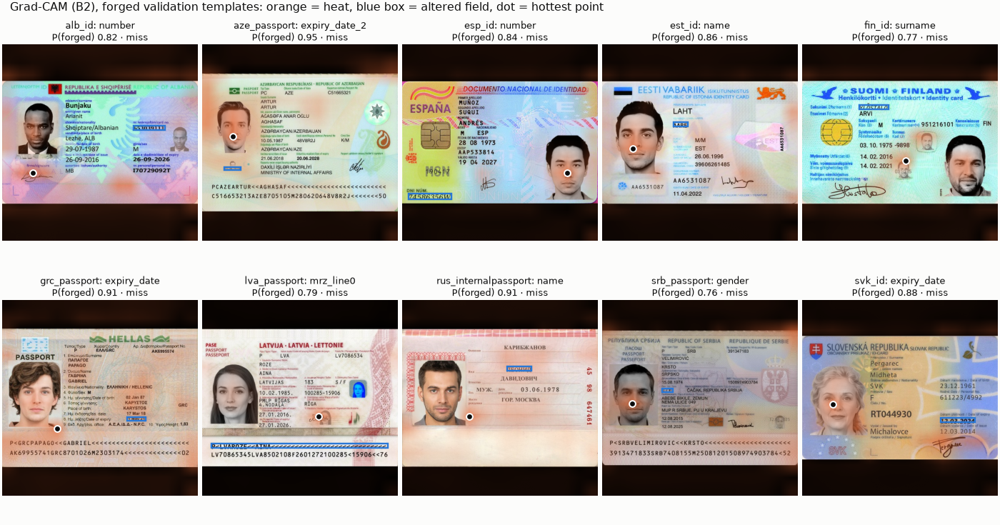
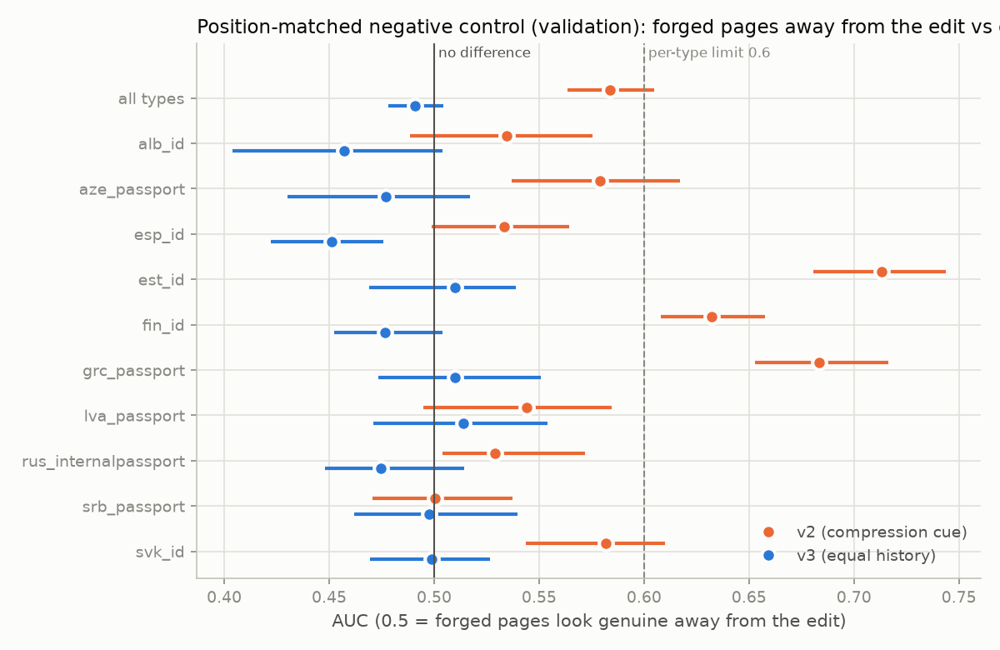
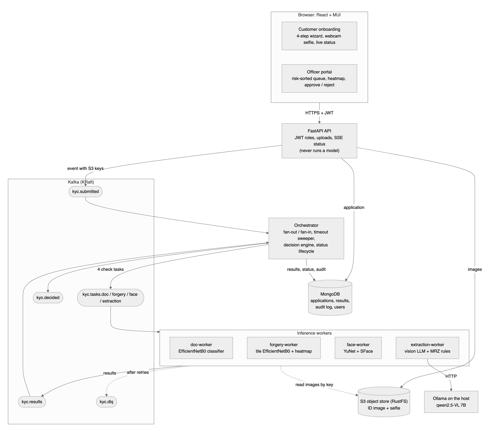
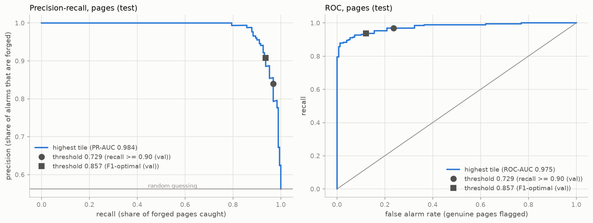
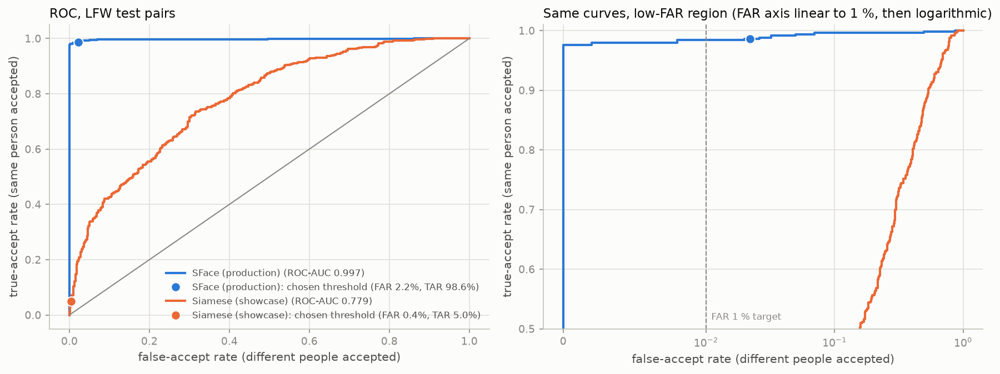

# Abstract

Banks must verify a customer's identity before opening an account. Remote onboarding (digital KYC) replaces the
branch visit with an uploaded identity document and a selfie, and it is exposed to forged documents and impersonation.

This project builds and evaluates a complete digital KYC pipeline with four independent checks:
- a document type classifier (EfficientNetB0 transfer learning);
- a forgery detector that scores 224-pixel tiles of a 1280-pixel page and shows the officer a heatmap;
- face verification of the selfie against the document portrait (YuNet and SFace);
- field extraction with a locally hosted vision language model (qwen2.5-VL 7B), checked by ICAO 9303 machine-readable
  zone (MRZ) rules.

A transparent rule-based decision engine combines the checks into auto-approval, manual review or a request to
resubmit. It never rejects an applicant on its own. The services communicate through Kafka, with the claim-check
pattern, idempotent result storage, retries, a dead-letter queue and a timeout sweeper. React interfaces serve the
customer and the bank officer.

All models were trained on synthetic documents (SIDTD) and on a public face benchmark (LFW), with group-based splits
that prevent leakage. Each test set was used once.

A central finding is a case study in shortcut learning. The first forgery model reached a validation PR-AUC of 0.976
while recognising how the files had been produced rather than the edits. After two diagnosed fixes, the accepted model
reaches a test ROC-AUC of 0.976 and PR-AUC of 0.984, and its top tile lies on the edited field for 95.3 % of forged
pages.

In a 150-application batch run through the live system, 67 of 68 fraudulent or mismatched applications (98.5 %) were
not auto-approved. The cost was that 27 of 75 legitimate applications were also sent to review.

# 1. Introduction and problem statement

## 1.1 Digital KYC in banking and financial services

Know-Your-Customer (KYC) rules oblige banks, insurers and other financial institutions (BFSI) to establish who
their customers are before doing business with them. The aims are to prevent money laundering, terrorist financing
and identity fraud. Regulators increasingly accept remote identification:
- in India, the Reserve Bank of India's Master Direction on KYC [12] allows a video-based customer identification
  process;
- the Financial Action Task Force has published guidance on digital identity [13].

Remote onboarding is cheaper and faster than a branch visit, but it moves the evidence into images that can be
manipulated. Three attacks matter most:
1. a **forged document**: a real document image with an altered field, such as a name or date of birth;
2. **impersonation**: a genuine document presented with someone else's face;
3. **inconsistent data**: details typed into the form that do not match the document.

An unusable image (black, blurred or not a document) is not an attack, but the system must still recognise it and ask
the customer for a new photo.

## 1.2 Problem statement and objectives

The project's question: can a set of independent, explainable machine-learning checks, combined by an auditable
decision policy, automate most of digital KYC while sending every doubtful case to a human? The objectives were:

1. Build leakage-safe training and evaluation data from a public synthetic identity-document dataset.
2. Train and evaluate a document type classifier, a forgery detector, a face verifier and an LLM-based field
   extractor, reporting precision, recall, F1, PR-AUC and confusion matrices rather than accuracy alone.
3. Prove that each model learned the intended signal, not an artefact of the dataset.
4. Integrate the models into an event-driven microservice system with a customer and an officer interface, an audit
   trail and role-based security.
5. Evaluate the whole system end to end against ground truth.
6. Package the system reproducibly, with containers, continuous integration and a model release.

## 1.3 Design principles

Four principles shaped the system:
- **No single check decides.** Every check produces evidence, and a pure, unit-tested function combines them.
- **The system never auto-rejects.** Only an officer can reject, with a written reason.
- **Customers never see fraud signals.** Exposing scores would teach a fraudster which attempt came closest.
- **Privacy:** no real identity data is used, and identity images never leave the machine, so the vision LLM runs
  locally.

# 2. Data

## 2.1 Datasets

**SIDTD** (Synthetic dataset of ID and Travel Documents) [1] provides forged and genuine versions of 10 European
identity documents. They are based on MIDV-2020 [2], whose documents carry generated faces and invented personal
data. The ten types are: Albanian, Spanish, Estonian, Finnish and Slovak ID cards; Azerbaijani, Greek, Latvian and
Serbian passports; and the Russian internal passport. Two subsets were used:
- **Templates:** 1,000 genuine flat document images (100 per type) and 1,222 forged ones.
  - Each forgery's JSON annotation names its method: *Inpaint_and_Rewrite* (1,077 distinct forgeries, text
    re-drawn) or *Crop_and_Replace* (145, real printed text pasted from another document).
  - It also names the source document and the altered field.
  - VIA annotations of the genuine templates give the boxes and values of every printed field and of the portrait.
- **Video clips:** 66,823 cropped frames of the 1,000 genuine documents, and 7,214 frames of 191 forged ones.

**LFW** (Labeled Faces in the Wild) [3] provides face pairs (2,200 for development training, 1,000 for testing; half
the same person) through scikit-learn.

## 2.2 Leakage-safe group splits

A document appears in the data many times: as a template, as forgeries derived from it and as video frames. Splitting
by image would put near-copies of one document into both training and test data, a classic leakage path [17].

The splits are therefore made by **document group**:
- a group is a genuine document together with every forgery derived from it and all their video frames;
- the derivation is read from the forgery's JSON `src` field, never from the file name. This matters: 72
  Crop_and_Replace file names name the donor document, not the source;
- when a forgery uses content from a second document (`second_src`), union-find merges both documents into one group.

The 927 resulting groups were split 70/15/15, stratified by document type and with seed 42: 649 training, 139
validation and 139 test groups. An automated check confirms that no group or document crosses splits.

Video frames are near-duplicates, so at most 8 frames per genuine document and 20 per forged document are kept. The
sampled manifest holds 14,027 images (Table 1). The forged share is 36 % in training and validation but 32 % in test,
which matters when reading precision and PR-AUC.

**Table 1. Images per split in the sampled manifest** (`reports/phase2/counts_split_label_source.csv`).

| Split | Forged clips | Forged templates | Genuine clips | Genuine templates | Total |
|---|---:|---:|---:|---:|---:|
| train | 2,776 | 853 | 5,616 | 702 | 9,947 |
| val | 589 | 179 | 1,200 | 150 | 2,118 |
| test | 440 | 190 | 1,184 | 148 | 1,962 |

## 2.3 Data findings that shaped the models

- **Colour format.** 500 genuine templates of five types are stored as CMYK files, while every forgery is RGB. A model
  reading raw files could learn the colour format. All training therefore uses a cache of resized RGB images built
  from the manifest.
- **Tiny edits.** An altered field covers a median 0.4 % of the image, about 11 pixels tall at 512 pixels. A 224-pixel
  downscale of the whole page would erase it.
- **Blank frames.** 62 genuine clip frames are blank or black (the dataset's automatic crop missed the card). They are
  flagged and excluded from forgery work.
- **Class imbalance.** Class weights from the training split are 0.79 for genuine and 1.37 for forged.

{width=80%}

# 3. Methodology

## 3.1 Document type classifier

The classifier is EfficientNetB0 [4], pretrained on ImageNet and used as a **frozen** backbone. A small head sits on
top: global average pooling, dropout (0.2) and a 10-way softmax. The input is a 224-pixel RGB image padded to a square
(`resize_with_pad`). Training ran in two stages:
1. **Stage 1:** the head only, learning rate 0.001, 15 epochs.
2. **Stage 2:** the top 20 backbone layers unfrozen, with their BatchNormalization layers kept frozen and a 100×
   lower learning rate.

Stage 2's first epoch gave the best validation loss and was checkpointed, but the second epoch diverged to NaN on the
Apple-GPU back end. Every later fine-tuning run therefore also used gradient clipping (`clipnorm=1.0`), a stop-on-NaN
callback and checkpointing on the best validation metric.

On validation the two checkpoints were practically equal:
- stage 1: accuracy 99.01 %, macro F1 0.9900;
- stage 2: accuracy 98.96 %, macro F1 0.9896.

The rule fixed in advance (highest macro F1) selected **stage 1**: the frozen ImageNet features already capture the
document layout. A rejection rule reports an "unrecognized document" when the highest softmax probability is below
0.77, a value chosen on validation.

## 3.2 Forgery detection and the shortcut-learning case study

### 3.2.1 Version 1: whole-image models

v1 trained two models on templates and clip frames together (9,910 training and 2,109 validation images; empty frames
excluded):
- **B1**, a simple five-block CNN baseline;
- **B2**, EfficientNetB0 at 512 pixels with the two-stage fine-tuning above.

On validation, B2 reached a PR-AUC of 0.976 and a ROC-AUC of 0.986. B1 reached 0.966 and 0.980.

These numbers did not survive scrutiny (Table 2):
- **Source breakdown:** split by source, B2 scored a PR-AUC of 0.999 on clip frames but only **0.591 on templates**,
  where chance is 0.544. Templates-only ROC-AUC was 0.53-0.57.
- **Grad-CAM** [6]: the class-activation maps lay on the altered field for **0 of 179** forged templates and 0 of 589
  forged clip frames (Figure 2). Because the TensorFlow gradient path crashed on the Apple GPU, Grad-CAM was
  implemented with an exact closed-form shortcut for this architecture.

The model had learned two **shortcuts** [5]:
1. every forged clip frame in SIDTD is a PNG from a separate recording, while genuine frames are MIDV-2020 JPEGs, so
   the label equals the recording style;
2. genuine templates are JPEG quality 92 and forged ones quality 75, so the compression level is a label cue.

Clip frames were therefore declared unusable for forgery work, and v1 was renamed `forgery_detector_v1_confounded`
and excluded from the pipeline.

**Table 2. Forgery v1 (B2) on validation, by source** (`reports/phase3/forgery_breakdown_source_val.csv`).

| Source | Images | Forged | Recall | False-alarm rate | Precision | PR-AUC |
|---|---:|---:|---:|---:|---:|---:|
| clip frames | 1,780 | 589 | 0.990 | 0.008 | 0.985 | 0.999 |
| templates | 329 | 179 | 0.609 | 0.507 | 0.589 | 0.591 |

{width=100%}

### 3.2.2 Version 2: tiles on high-resolution templates

v2 changed the data and the input:
- **templates only**, each page resized so its longest side is exactly 1280 pixels and saved at JPEG quality 75,
  whatever its class;
- **tiles:** each page is cut into 224-pixel tiles with a stride of 112 pixels (50 % overlap), and EfficientNetB0
  classifies each tile.

A tile is labelled forged if it shows the edit, clean if it does not, and ignored if it overlaps the edit only
partly. The training data held 1,555 pages, with 5,702 edit tiles and 118,729 clean tiles. A page's score is an
aggregate of its tile scores; the pre-registered rule was the mean of the top three tiles.

On validation, v2 reached a document PR-AUC of 0.983 and a ROC-AUC of 0.974. The top tile touched the edit on 93.9 %
of forged pages. A plain negative control also looked clean: tiles of forged pages away from the edit scored like
genuine tiles (AUC 0.49).

That control had a blind spot: off-edit tiles come from different parts of the page than edit tiles. The
**position-matched control** fixes this:
- it compares tiles at the same positions on genuine and forged pages, with the edit tiles excluded;
- an AUC of 0.5 means "no page-level cue".

For v2 it was **0.584** overall [0.564, 0.605] and **0.713 on est_id** (Figure 3). A second test, the
**edit-hidden ROC-AUC**, scores pages with every edit tile removed; it was 0.583. Something other than the edit still
separated the classes.

The cause was **compression history**:
- forged originals had been saved at quality 75 at their *original* size;
- on the four document types that are enlarged to 1280 pixels (est_id, fin_id, svk_id, grc_passport), the
  stretched 8×8 JPEG block pattern of that save survives the final save.

Giving v2's genuine pages the same history doubled its false alarms, from 5 to 11 of 150, which confirms that v2 used
the cue.

### 3.2.3 Version 3: equal compression history

v3 gives every genuine page the forged pages' history first: a quality-75 save at the original size, then the usual
resize and quality-75 save. File sizes and estimated qualities then match across classes.

Before training, three stop rules were fixed: limits on the position-matched control overall and per type, and on the
edit-hidden ROC-AUC. v3 passed all three:
- position-matched control **0.491** [0.478, 0.504], highest type 0.514;
- edit-hidden ROC-AUC **0.403**.

The honest price was a lower validation score (Table 3):
- PR-AUC 0.963 and ROC-AUC 0.939;
- at a recall of 0.90, 32 false alarms instead of 5.

On aggregation, the highest tile (PR-AUC 0.9632) and the top-3 mean (0.9629) were a practical tie, and the
pre-registered rule chose the highest tile.

Two thresholds were chosen on validation:
- **0.729** gives a recall of at least 0.90 (precision 0.835) and becomes the "needs review" level;
- **0.857383**, the best F1 (0.905), becomes the "forgery suspected" level.

The production worker applies exactly the training preprocessing to every upload: the original-size save, the resize
and the final save.

**Table 3. v2 against v3 on the same validation pages** (`reports/phase3/forgery_v3_vs_v2_val.csv`).

| | v2 (compression cue) | v3 (equal history) |
|---|---:|---:|
| Document PR-AUC / ROC-AUC | 0.983 / 0.974 | 0.963 / 0.939 |
| Tile PR-AUC | 0.874 | 0.868 |
| False alarms at recall ≥ 0.90 (of 150 genuine) | 5 | 32 |
| Position-matched control, all types | 0.584 | 0.491 |
| Position-matched control, highest type | 0.713 (est_id) | 0.514 (lva_passport) |
| Edit-hidden ROC-AUC (top-3 score) | 0.583 | 0.386 |
| Top tile on the edit | 93.9 % | 93.3 % |
| Recall, Crop_and_Replace (22 forged) | 0.41 | 0.32 |

{width=85%}

The lesson recurs throughout the project: **a high score is not evidence that a model learned the right thing.**
Localisation, a position-matched control and an edit-hidden score are required, together with a breakdown by data
source.

## 3.3 Face verification

The production path uses two OpenCV Zoo models:
- **YuNet** [8], a lightweight face detector;
- **SFace** [7], a face recognizer producing 128-dimensional embeddings. The score is the cosine similarity of the
  two embeddings.

The threshold, 0.2597, gives the highest true-accept rate at a false-accept rate (FAR) of at most 1 % on the 2,200
LFW development pairs. A FAR target was chosen because accepting an impostor is the costly KYC error.

As a deep-learning showcase, a **Siamese network** [9] was trained on LFW with an identity-disjoint split (1,868
fitting pairs, 332 validation pairs, 12 epochs). It scored a test ROC-AUC of only 0.779 and is not used in the
pipeline: 2,200 pairs are far too few to learn face embeddings from scratch.

LFW is not the KYC setting, so a synthetic sanity check paired ID portraits with simulated selfies (rotation, scale,
lighting, blur, JPEG):
- **matching pairs** were accepted in 99.9 % of cases (median score 0.927);
- **pairs of two different documents** were accepted in **29.9 %** of cases, because SIDTD's generated portraits look
  alike and some are even reused across documents.

The decision policy therefore treats scores between 0.2597 and 0.556 as "needs review"; 0.556 kept the FAR at or
below 1 % on the portrait pairs. "No face found" always means a retake or a review, never acceptance.

## 3.4 Generative-AI field extraction and MRZ rules

Fields are extracted by **qwen2.5-VL 7B** [10], served locally by Ollama:
- a cloud vision API would have been easier, but sending identity documents to a third party conflicts with privacy
  regulation and bank policy, so the on-premises model is a deliberate design choice;
- the model receives the document resized to 1280 pixels on its longest side (full size uses about 3,900 of its
  4,096-token context) and a prompt that asks for a fixed JSON schema of 13 fields;
- the answer is validated with Pydantic, and the model is asked again (at most twice) if it is invalid;
- generation is capped (512 output tokens, repeat penalty 1.05, a request timeout), because the model once looped on
  the MRZ's `<` fillers.

The prompt was developed on 30 genuine **validation** documents. Version 2 fixed three error patterns of version 1:
- the Azerbaijani passport number;
- transliteration of Greek and Azerbaijani names;
- diacritics.

This raised normalized field accuracy on the development set from 96.2 % to 96.8 %. The prompt was then frozen and
run once on the 148 genuine **test** templates.

**Consistency rules** turn the extraction into forgery evidence:
- ICAO 9303 MRZ format and check digits [11] for the document number, birth date, expiry date and composite;
- cross-checks between the MRZ and the printed surname, given names, birth date, document number and expiry date;
- date parsing and date order.

Every rule was first tested on the **ground truth** of all 1,000 genuine documents:
- each rule flagged at most 0.75 % of them;
- all 400 MRZs passed every check digit;
- the nine flags all trace back to inconsistencies inside the synthetic dataset.

The officer's case summary is generated from a template; an LLM summary is shown only as a labelled "AI-assisted
note", after one test summary added an unsupported interpretation.

# 4. System architecture

{width=95%}

## 4.1 Event-driven orchestration

The system consists of seven processes (Figure 4).

**The API** (FastAPI) is deliberately thin. It authenticates users, stores the two images in an S3-compatible object
store (RustFS), creates the application in MongoDB and publishes `kyc.submitted`. It never runs a model.

**The orchestrator** consumes that event and publishes one task per check:
- the tasks go to `kyc.tasks.doc`, `.forgery`, `.face` and `.extraction`;
- each of four **workers** consumes its topic, loads one model, reads the images from the object store and publishes
  a result to `kyc.results`;
- when all four results are in, the orchestrator runs the decision engine, moves the status and publishes
  `kyc.decided`.

Orchestration (a central coordinator) was chosen over choreography, where services react to each other's events. With
an orchestrator:
- the fan-in point and the timeout logic live in one place;
- the decision is made exactly once;
- the audit trail has a single writer.

Choreography would spread "is this application complete?" across four services.

Reliability rests on standard messaging patterns [14, 15]:
- **Claim check:** events carry S3 object keys, never images. Messages stay small, and the images are stored once.
- **Partitioning by application id:** all events of one application stay in order.
- **At-least-once processing:** offsets are committed only after processing. Results are *upserted* in MongoDB under a
  unique index on (application id, check type), so a redelivered result is harmless (**idempotency**).
- **Retries and a dead-letter queue (DLQ):** transient errors are retried with exponential backoff. An invalid event,
  or one that still fails, goes to `kyc.dlq` with its error.
- **Timeouts:** a sweeper marks any check without a result after its deadline as `timed_out`. That sends the case to
  manual review instead of leaving it waiting forever.

Kafka runs as a single KRaft node. Under macOS memory pressure the broker stalled, so its session timeout was raised to
60 seconds, and the workers wait up to five minutes for Kafka and tolerate failed offset commits. All events share a
Pydantic envelope: event id, application id, type, schema version, timestamp and payload.

## 4.2 Decision engine and risk

The decision engine (`src/ekyc/decision.py`) is a **pure function** of the four check results and the details the
applicant typed. Its thresholds are read from the model configuration files. Each check contributes **reasons** with
an effect and the evidence behind it (Table 4).

The outcome follows from the reasons, in this order of precedence:
1. an unusable document image (blank or unrecognized) → **RESUBMIT_REQUIRED**, and the other checks are skipped;
2. any `high` reason → **MANUAL_REVIEW** (high), even if another reason asks for a retake: a suspected fraud is never
   just bounced back for another try;
3. any other `resubmit` reason, such as no face on the selfie → **RESUBMIT_REQUIRED**;
4. any `medium` reason → **MANUAL_REVIEW** (medium);
5. otherwise → **AUTO_APPROVED**.

The risk score adds 50 points per high reason and 20 per medium reason, up to 10 points for the forgery score and up to
10 for a weak face score, and is capped at 100. It orders the officer's queue. **The system never auto-rejects.**

**Table 4. Main decision rules.**

| Check | Evidence → effect |
|------|------------------|
| Document image | blank or unreadable → resubmit; classifier confidence below 0.77 ("unrecognized document") → resubmit |
| Face | no face found → resubmit; score < 0.2597 → high (mismatch); 0.2597-0.556 → medium |
| Forgery | score ≥ 0.857383 → high ("forgery suspected"); 0.729-0.857 → medium |
| Typed details vs extraction | date of birth differs → high; name differs (fuzzy similarity < 0.85) or date of birth unreadable → medium |
| Consistency rules | "strong" rules (MRZ check digits, MRZ vs document number and expiry, date order) → high; "review" rules (MRZ format, MRZ vs names and birth date, unparseable dates) → medium |
| Any check timed out, failed or missing | medium |
| Document expired | information only (74 % of the synthetic templates are expired) |

The "strong" rules false-flag at most 3.4 % of genuine test passports even on LLM-extracted fields. The "review" rules
count as medium only, because of the evaluation in Section 5.4: the 7B model misreads MRZ name lines on genuine
passports, with up to 27 % false flags.

## 4.3 Status lifecycle and audit

An application moves `SUBMITTED → PROCESSING`, then:
- to `APPROVED` (auto-approved, actor "system");
- to `RESUBMIT_REQUESTED`;
- or to `DECIDED`, the officer queue. An officer then moves it to `APPROVED` or `REJECTED`, and a rejection needs a
  written reason.

Every transition is a conditional, atomic update: the status changes only if it still has the expected previous value,
so two officers cannot both decide a case. Each transition is appended to an audit log with a deterministic id.

## 4.4 Security and privacy controls

- **Authentication:** JWT bearer tokens with the roles CUSTOMER and OFFICER, 30-minute expiry and argon2 password
  hashing.
- **Isolation between customers:** another customer's application returns *404*, which hides that it exists.
- **Uploads:** checked for content type (JPEG or PNG) and a 10 MB size limit.
- **Officer images:** officers view them through presigned links that expire.
- **Logs:** names and dates of birth are masked.
- **Customer view:** the customer interface receives a whitelisted status object (outcome and a neutral reason), and a
  unit test fails if fraud-signal names appear in customer code. Officers see every score, rule, the heatmap and the
  audit trail.

## 4.5 Interfaces, packaging and operations

**Frontend** (React, TypeScript, Vite, MUI):
- **customer:** a four-step wizard (details, document, webcam or uploaded selfie, review) and a live status page fed
  by Server-Sent Events;
- **officer:** a queue sorted by risk and a case detail page with the images, a forgery heatmap overlay, every check,
  approve or reject, and the audit trail;
- **analytics:** three dashboards (operations, risk & fraud, model performance), the officer portal's *Analytics* tab,
  and public on the demo site (see *Operations* below);
- the API's TypeScript types are generated from its OpenAPI schema.

**Docker:**
- **Python services:** one multi-stage Dockerfile with three targets (API, orchestrator, workers), slim and non-root,
  with healthchecks and models mounted read-only;
- **frontend:** an nginx image whose API address is set when the container starts.

**Operations:**
- **CI:** GitHub Actions runs linting and the unit tests of both code bases.
- **Dashboards:** a script exports pseudonymous, PII-free CSV tables of the batch, and a second script bundles them
  with the frontend as a 90 KB JSON snapshot.
  - Three dashboards built into the app with MUI X Charts show it: operations, risk & fraud, and model performance.
    They are filterable by document type and outcome, and each chart has a table view.
  - Tests check that the numbers match `reports/` exactly.
  - Tableau Public was dropped: it is GUI-only and could not be automated or tested (the CSVs and a build guide
    remain).
- **Model release:** the trained weights are published as one checksum-verified release.

# 5. Evaluation

All results in this section are one-time test evaluations, with thresholds frozen on validation, unless stated
otherwise. Table 5 summarises them.

**Table 5. One-look test results.**

| Model | Test data | Key results |
|-----|-----|----------------|
| Document classifier | 1,962 images | accuracy 99.29 %, macro F1 0.993; 1.48 % below the confidence threshold |
| Forgery detector v3 | 338 template pages (190 forged) | ROC-AUC 0.976 [0.959, 0.989], PR-AUC 0.984 [0.974, 0.992] |
| Face verification (SFace) | 1,000 LFW pairs | ROC-AUC 0.997, EER 1.6 %, TAR 98.4 % at FAR 1 %; at the threshold FAR 2.2 %, FRR 1.4 % |
| Field extraction | 148 genuine templates, 1,547 fields | valid JSON 99.3 %, exact 84.1 %, normalized 95.2 %, CER 1.8 % |

## 5.1 Document classifier

- **Test accuracy is 99.29 %** and the macro F1 is 0.993.
- **By source:** templates are classified perfectly (forged and genuine), and clip frames reach 98.9-99.8 %.
- **Rejection rule:** 1.48 % of test images fall below the confidence threshold.
- **The rule does not reject non-documents reliably:** 16.5 % of LFW face photos passed it. The classifier is
  therefore never the only gate; image quality, face detection and extraction complement it.

## 5.2 Forgery detector

The test run (Figure 5) gives a ROC-AUC of 0.976 and a PR-AUC of 0.984, with 95 % bootstrap intervals [16, 19].

| Threshold | Recall | Precision | Genuine pages flagged |
|---|---:|---:|---|
| 0.729 | 0.968 | 0.840 | 35 of 148 (23.6 %) |
| 0.857 | 0.937 | 0.908 | 18 (12.2 %) |

The shortcut checks hold on test:
- position-matched control 0.484;
- edit-hidden ROC-AUC 0.459;
- the top tile touches the edit on **95.3 %** of forged pages, against a 10.8 % chance for a random tile.

Weak spots:
- **By method:** recall is 0.988 for Inpaint_and_Rewrite and 0.778 for Crop_and_Replace (14 of 18) at the 0.729
  threshold. Crop_and_Replace caught only 7 of 22 on validation, which shows how much small groups move between
  splits.
- **False alarms concentrate on est_id:** 11 of its 15 genuine test pages are flagged.

{width=85%}

## 5.3 Face verification

On the 1,000 LFW test pairs, SFace reaches:
- a ROC-AUC of 0.997 and an EER of 1.6 %;
- a true-accept rate of 98.4 % at a FAR of 1 %.

At the frozen threshold the FAR is 2.2 %, above the 1 % target; the threshold was not changed after the one-time
test. The Siamese network reaches a ROC-AUC of 0.779 and an EER of 30.0 %. YuNet detected a face in every LFW image and
in 99.9 % of ID portraits. It missed one dark, low-contrast portrait (est_id_64), which is a fairness concern discussed
in Section 7.

{width=75%}

## 5.4 Field extraction and rules

On the 148 genuine test documents:
- 99.3 % of answers were valid JSON; one passport extraction looped and failed;
- exact field accuracy is 84.1 %, normalized accuracy (case, spacing, punctuation and date formats) 95.2 %, and the
  mean character error rate 1.8 %;
- median latency is 31.6 s.

By field:
- names reach 91.9 % (surname) and 92.6 % (given names);
- dates and document numbers about 99 %;
- the MRZ lines are the weakest, at 76.7 % and 65.0 %.

Two experiments decided how the rules are used:
1. **Forged MRZ documents** (155 forged pages of the four passport types, from validation and test). Combining the
   pixel model with the rules raises detection of Crop_and_Replace forgeries from **46 % to 71 %** (17 of 24),
   counting only rule flags on the field the forger altered.
2. **The rules on *extracted* fields of genuine test documents.** **23 of 60** MRZ passports (38 %) received at least
   one flag, although the ground truth flags none. The cause is reading errors: the given-names cross-check alone
   flagged 27 %. Hence MRZ name mismatches only mean "needs review".

## 5.5 End-to-end batch evaluation

To evaluate the whole system rather than the models, 150 applications were submitted through the API of the running
system:
- **documents:** test-split templates only;
- **scenarios:** 50 % genuine; 25 % forged with the fraudster's own selfie; 8 % genuine with wrong typed details; 7 %
  a stranger's selfie; 5 % blank or unreadable images; 5 % forged with a stranger's selfie;
- **ground truth** was recorded separately, and nothing was tuned on the batch.

**Table 6. System decision against ground truth** (`reports/phase9/batch_summary.md`).

| Ground truth | AUTO_APPROVED | MANUAL_REVIEW | RESUBMIT_REQUIRED | Total |
|---|---:|---:|---:|---:|
| Fraud or mismatch | 1 | 67 | 0 | 68 |
| Legitimate | 48 | 27 | 0 | 75 |
| Unusable image | 0 | 0 | 7 | 7 |
| Total | 49 | 94 | 7 | 150 |

**Fraud:**
- **67 of 68** fraudulent or mismatched applications (98.5 %) were not auto-approved;
- all 45 forged documents went to review, all four Crop_and_Replace forgeries included, as did all 12 wrong-detail
  applications;
- the only miss was a stranger's selfie on a Serbian passport. The synthetic portraits looked alike, and the face
  score of 0.6305 lay above the review band.

**Legitimate applications:**
- **48 of 75** (64 %) were auto-approved, and none was asked to resubmit;
- among the 27 false alarms, 15 carried a forgery-model flag and 10 the MRZ given-names flag (some carried both);
- 17 of the 27 were medium risk.

**Unusable images:** all 7 were sent back for a retake within seconds.

**The officer step:** a simulated officer worked the queue from the highest risk down. It rejected 56 cases and
approved 10. Because the simulated officer used the ground truth, this demonstrates the workflow, not human accuracy.

**Latency:** the median time to decision was 77 s, on a 16 GB laptop with 12-13 GB of swap in use. Median worker
times were 1.5 s for the document check, 1.6 s for face, 6.4 s for forgery and 29.4 s for extraction. A Kafka stall
of about 60 s caused timeouts in 2 applications, which went to manual review as designed.

{width=90%}

## 5.6 Engineering verification

- **Python tests:** 267, of which 235 run in CI without services, model weights or data.
- **Frontend:**
  - 104 Vitest unit tests, including the dashboard self-check against `reports/phase9/batch_summary.json`;
  - 4 Playwright end-to-end tests that drive the real system;
  - 10 that run against the static demo site, 5 of them for the dashboards.
- **API smoke test:** 4 cases plus 6 security checks (wrong role ×2, another customer's application, missing,
  invalid and expired tokens).

**Containers.** With Docker's memory at 4 GB, the forgery worker was killed by the operating system's out-of-memory
handler at 1.33 GB. With 6 GB, the containerized smoke test passed every case:
- the genuine applicant was auto-approved in 30.6 s;
- peak memory was 4.13 GB (`reports/phase9/docker.md`).

# 6. Limitations

- **Synthetic, narrow data:**
  - ten European document types as flat scans; no Indian documents, no phone photos with glare or perspective, no
    real selfie-ID pairs;
  - every threshold was calibrated on synthetic data or LFW, and must be recalibrated on real, consented data.
- **Manual-review rate:** 63 % of the batch went to an officer. Forgery false alarms cluster on est_id, and the 7B
  model misreads MRZ name lines.
- **Crop_and_Replace forgeries** remain the hardest for pixel models. The rules help only where the MRZ repeats the
  edited field.
- **Face matching on generated portraits:** different documents matched in 29.9 % of pairs, and the batch's one miss
  came from this. LFW's FAR of 2.2 % does not transfer to ID portraits.
- **Scope:** there is no liveness or anti-spoofing check, no sanctions or PEP screening, and no NFC chip reading.
- **Throughput:** one local LLM processes extractions one at a time (20-30 s each), so concurrent applications queue.
- **Single-node infrastructure:** Kafka is a single broker with no replication.
- **Small test groups:** per-type and per-method numbers rest on 13-50 pages, and their intervals are wide.

# 7. Ethics and privacy

- **No real personal data.** SIDTD documents carry generated faces and invented details. LFW (photos of public
  figures) is used only to train and evaluate face matching. The dataset is not redistributed;
  only a few example pairs appear in figures.
- **Data protection by design.** The vision LLM runs on the premises, so no document is sent to a cloud API. Further
  safeguards:
  - logs mask names and birth dates;
  - images are reachable only through expiring links;
  - dashboard exports use pseudonymous ids, and a guard rejects PII-like columns.
- **Human oversight.** The system never auto-rejects, and every rejection needs a written reason in an append-only
  audit log. This supports contestability and regulatory review.
- **Transparency without gaming.** Officers see every score and rule; customers see only the outcome and a neutral
  reason, so fraudsters cannot probe the thresholds. Legitimate customers who are sent to review can still be told
  that a person will check their application.
- **Fairness.** Two signals need monitoring on real data:
  - YuNet missed one dark, low-contrast portrait, which echoes known demographic differentials in face analysis;
  - forgery false alarms are uneven across document types. Applicants from one country could face more manual
    review.

  A production system would measure error rates per demographic group and document type before deployment.
- **Licences.**
  - Datasets: SIDTD and MIDV-2020 are used under their Creative Commons ShareAlike terms, with citation.
  - Models: YuNet (MIT), SFace, EfficientNet weights and Qwen2.5-VL 7B (Apache 2.0) are used within their licences.

# 8. Conclusion

The project delivers a working, tested and packaged digital KYC prototype. Four layered checks are combined by an
explainable policy, with humans in the loop for every doubtful case.

On synthetic data the individual models perform strongly:
- the document classifier at 99.3 % accuracy;
- the forgery detector at ROC-AUC 0.976;
- face verification at ROC-AUC 0.997;
- field extraction at 95.2 % normalized accuracy.

Run as a system, they caught 67 of 68 fraudulent applications in a batch evaluated against ground truth.

The most valuable result is methodological. The forgery case study shows how easily a convincing metric can come from
a dataset artefact, and how source breakdowns, localisation checks and a position-matched negative control expose it.

The main weaknesses lie in operations and data, not architecture:
- too many legitimate applications go to review;
- everything was calibrated on synthetic documents.

The next steps are therefore:
- recalibration on real, consented data;
- a dedicated MRZ reader;
- liveness detection;
- forgery training on phone photos.

# References

1. Boned, C., Talarmain, M., Ghanmi, N., Chiron, G., Biswas, S., Awal, A. M., & Ramos Terrades, O. (2024). Synthetic
   dataset of ID and Travel Documents. *Scientific Data*, 11. arXiv:2401.01858.
2. Bulatov, K., Emelianova, E., Tropin, D., Skoryukina, N., Chernyshova, Y., Sheshkus, A., Usilin, S., Ming, Z.,
   Burie, J.-C., Luqman, M. M., & Arlazarov, V. V. (2022). MIDV-2020: A comprehensive benchmark dataset for identity
   document analysis. *Computer Optics*, 46(2), 252-270. arXiv:2107.00396.
3. Huang, G. B., Ramesh, M., Berg, T., & Learned-Miller, E. (2007). *Labeled Faces in the Wild: A database for
   studying face recognition in unconstrained environments* (Technical Report 07-49). University of Massachusetts,
   Amherst.
4. Tan, M., & Le, Q. V. (2019). EfficientNet: Rethinking model scaling for convolutional neural networks.
   *Proceedings of ICML*.
5. Geirhos, R., Jacobsen, J.-H., Michaelis, C., Zemel, R., Brendel, W., Bethge, M., & Wichmann, F. A. (2020).
   Shortcut learning in deep neural networks. *Nature Machine Intelligence*, 2, 665-673.
6. Selvaraju, R. R., Cogswell, M., Das, A., Vedantam, R., Parikh, D., & Batra, D. (2017). Grad-CAM: Visual
   explanations from deep networks via gradient-based localization. *Proceedings of ICCV*.
7. Zhong, Y., Deng, W., Hu, J., Zhao, D., Li, X., & Wen, D. (2021). SFace: Sigmoid-constrained hypersphere loss for
   robust face recognition. *IEEE Transactions on Image Processing*, 30, 2587-2598.
8. Wu, W., Peng, H., & Yu, S. (2023). YuNet: A tiny millisecond-level face detector. *Machine Intelligence Research*,
   20, 656-665.
9. Bromley, J., Guyon, I., LeCun, Y., Säckinger, E., & Shah, R. (1993). Signature verification using a "Siamese"
   time delay neural network. *Advances in Neural Information Processing Systems 6*.
10. Bai, S., et al. (2025). Qwen2.5-VL technical report. arXiv:2502.13923.
11. International Civil Aviation Organization. *Doc 9303: Machine Readable Travel Documents* (8th ed.).
12. Reserve Bank of India. *Master Direction - Know Your Customer (KYC) Direction, 2016* (as updated).
13. Financial Action Task Force (2020). *Guidance on Digital Identity*. FATF, Paris.
14. Hohpe, G., & Woolf, B. (2003). *Enterprise Integration Patterns*. Addison-Wesley.
15. Kleppmann, M. (2017). *Designing Data-Intensive Applications*. O'Reilly.
16. Saito, T., & Rehmsmeier, M. (2015). The precision-recall plot is more informative than the ROC plot when
    evaluating binary classifiers on imbalanced datasets. *PLoS ONE*, 10(3), e0118432.
17. Kaufman, S., Rosset, S., Perlich, C., & Stitelman, O. (2012). Leakage in data mining: Formulation, detection, and
    avoidance. *ACM Transactions on Knowledge Discovery from Data*, 6(4), 1-21.
18. Kreps, J., Narkhede, N., & Rao, J. (2011). Kafka: A distributed messaging system for log processing.
    *Proceedings of the NetDB Workshop*.
19. Efron, B., & Tibshirani, R. J. (1993). *An Introduction to the Bootstrap*. Chapman & Hall.

# Appendix A. Where every number comes from

| Section | Source files |
|-----|----------------|
| 2 Data | `reports/phase2/counts_split_label_source.csv`, `class_weights_train.json`, `ctype_distribution.csv` |
| 3.1, 5.1 Document classifier | `reports/phase3/doc_classifier_metrics.json`, `doc_classifier_report_{val,test}.csv`, `doc_classifier_accuracy_by_source_label.csv` |
| 3.2, 5.2 Forgery | `reports/phase3/forgery_metrics_val.json` (v1), `forgery_breakdown_source_val.csv`, `forgery_v2_metrics_val.json`, `forgery_v3_vs_v2_val.csv`, `forgery_v3_metrics_test.json`, `summary.md` |
| 3.3, 5.3 Face | `reports/phase4/face_metrics.json` |
| 3.4, 5.4 Extraction | `reports/phase5/phase5_metrics.json`, notebook `05_field_extraction` |
| 5.5 Batch | `reports/phase9/batch_summary.{md,json}`, `dashboard/data/*.csv`, `frontend/src/dashboards/snapshot.json` |
| 5.6 Containers | `reports/phase9/docker.md`, `e2e_api_containers_6gb.json` |
